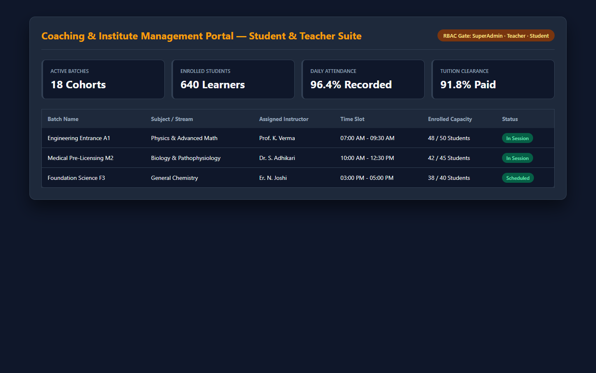
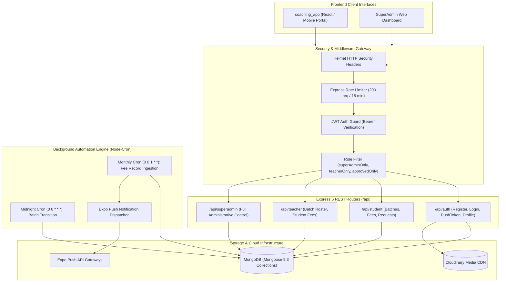
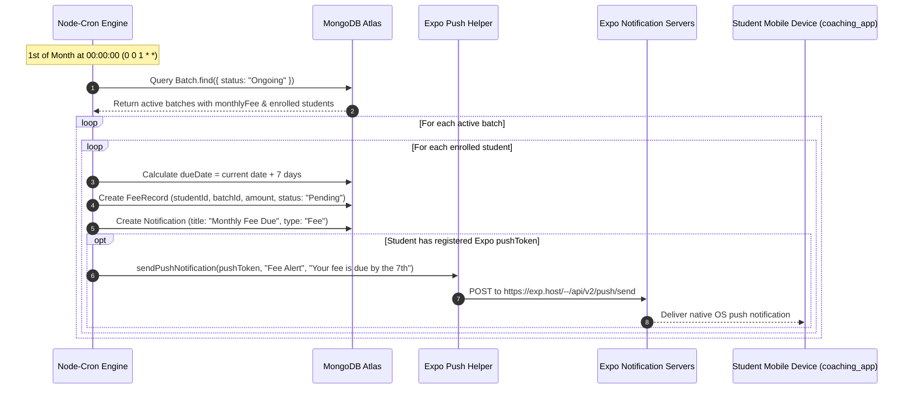

# Coaching & Institute Management System — Core Backend

[](https://opensource.org/licenses/MIT)
[](https://nodejs.org/)
[](https://expressjs.com/)
[](https://www.mongodb.com/)
[](https://github.com/node-cron/node-cron)
[](https://expo.dev/notifications)
[](https://cloudinary.com/)
[](../coaching_app)

---

## Application Screenshot & Interface Preview

<div align="center">
  
</div>

---

## 🔗 Ecosystem Linkage
> **Client Application**: This repository powers the frontend client interface documented in [**`coaching_app`**](../coaching_app). Together, they form a cohesive, full-stack coaching center and tuition management platform.

---

## 📋 Executive Summary & Problem Solved

Independent coaching institutes, private tuition centers, and exam academies operate under complex operational constraints that generic school ERP systems fail to service effectively:

1. **Chaotic Batch Enrollments**: Students enroll across multiple distinct subject batches with differing start dates, monthly fee structures, and instructor assignments.
2. **Uncollected & Overdue Tuition Fees**: Tracking monthly tuition collection manually across hundreds of students leads to revenue leakage, missed follow-ups, and strained parent-teacher interactions.
3. **Unregulated Student Access**: Self-registration without administrative approval allows unverified users to view internal schedules and class materials.
4. **Communication Friction**: Important fee reminders, batch rescheduling notices, and completion updates sent through generic chat apps get lost or ignored.

**Coaching App Backend** provides a high-reliability, security-hardened REST API built on **Express 5** and **Mongoose 9**. It features strict **3-Tier RBAC (SuperAdmin, Teacher, Student)** with administrative admission gates (`approvedOnly`), automated **midnight batch lifecycle transitions**, monthly automated **tuition fee schedule generation**, and instant **mobile push notifications** via Expo.

---

## ✨ Key Features

- 👥 **3-Tier Role-Based Access Control**:
  - 👑 **SuperAdmin**: Full institutional authority over teachers, batches, student approvals, and fee payment reconciliation.
  - 👨‍🏫 **Teacher**: Dedicated visibility into assigned batch schedules, enrolled students, and tuition clearance records.
  - 🎓 **Student**: Secure self-service portal to browse available courses, submit batch admission requests, track fee status, and view receipts.
- 🔒 **Administrative Approval Gate (`approvedOnly`)**: Self-registered student accounts remain quarantined until formally approved by a SuperAdmin.
- ⏰ **Automated Lifecycle & Fee Generation Crons**:
  - **Midnight Batch Transition** (`0 0 * * *`): Automatically rolls `Upcoming` batches to `Ongoing` when the calendar start date is reached.
  - **Monthly Tuition Billing** (`0 0 1 * *`): Generates monthly `FeeRecord` items for all students in active batches due on the 7th of the month.
- 📲 **Expo Push Notification Integration**: Automatically triggers real-time mobile alerts directly to students' smartphones whenever new batches start, fees are billed, or requests are approved.
- 💳 **Fee Payment Reconciliation Engine**: Fast toggle endpoint for SuperAdmin to record cash/online payments, stamp timestamps, and clear due balances.
- 🖼️ **Cloudinary Profile Picture Storage**: Cloud-hosted media ingestion for verified student identity badges and teacher avatars.
- 🛡️ **Defense-in-Depth Security**: Pre-configured with Helmet security headers, 15-minute windowed API rate limiting (200 requests/IP), and bcrypt salt-hashed passwords.

---

## 🏗️ System Architecture



---

## 🔄 Monthly Fee Generation & Push Notification Sequence



---

## 🛠️ Tech Stack

| Domain | Technology | Version | Description |
| :--- | :--- | :--- | :--- |
| **Runtime** | Node.js | `>= 18.0.0` | Asynchronous JavaScript backend runtime |
| **Web Framework** | Express.js | `^5.2.1` | Next-generation Express 5 routing framework |
| **Database & ODM** | MongoDB / Mongoose | `^9.3.3` | Object Data Modeling with strict schema validation |
| **Scheduler** | Node-Cron | `^4.2.1` | In-memory cron runner for scheduled batch & billing tasks |
| **Push Gateway** | Expo Push Notifications | Custom Helper | Mobile alert dispatching to iOS & Android clients |
| **Media Hosting** | Cloudinary | `^2.9.0` | Cloud hosting for student and teacher profile photos |
| **Authentication** | JSON Web Tokens (`jsonwebtoken`) | `^9.0.3` | Signed stateless JWT session verification |
| **Password Security**| `bcrypt` | `^6.0.0` | Native cryptographic password hashing |
| **Traffic Defense** | `express-rate-limit` + `helmet` | `^8.3.2` / `^8.1.0` | Rate limiting & HTTP response header hardening |

---

## 📂 Repository Directory Structure

```text
coaching_app_backend/
├── backend/
│   ├── config/
│   │   └── db.js                     # MongoDB connection pool logic
│   ├── cron/
│   │   └── feeNotifier.js            # Node-cron schedules: batch auto-transition & monthly fees
│   ├── middleware/
│   │   └── auth.js                   # JWT protect, superAdminOnly, teacherOnly, approvedOnly
│   ├── models/
│   │   ├── Batch.js                  # Batch model: subject, timing, fee, assigned students
│   │   ├── BatchRequest.js           # Student admission request to join a batch
│   │   ├── Counter.js                # Auto-incrementing sequence counter for receipts
│   │   ├── FeeRecord.js              # Tuition record: month, year, amount, status (Paid/Pending)
│   │   ├── Notification.js           # In-app notifications with read/unread tracking
│   │   └── User.js                   # Core user: SuperAdmin, Teacher, Student + pushToken
│   ├── routes/
│   │   ├── authRoutes.js             # User registration, login, profile, avatar, push tokens
│   │   ├── studentRoutes.js          # Student schedule, fee status, batch enrollment requests
│   │   ├── superAdminRoutes.js       # Teacher management, batch CRUD, fee reconciliation
│   │   └── teacherRoutes.js          # Teacher assigned batches, student rosters, fee overviews
│   ├── utils/
│   │   ├── cloudinary.js             # Cloudinary SDK image upload wrapper
│   │   └── pushHelper.js             # Expo push notification formatting and delivery
│   ├── .env.example                  # Sanitized environment configuration template
│   ├── cleanNotifs.js                # Maintenance script to purge historic notifications
│   ├── index.js                      # Application entry point, Express middleware & server
│   └── package.json                  # NPM dependencies and execution scripts
├── .gitignore                        # Git exclusion rules
└── README.md                         # Core backend documentation
```

---

## ⚙️ Local Setup & Installation

### Prerequisites
- **Node.js**: v18.x or v20.x LTS installed
- **MongoDB**: Local MongoDB daemon (`mongodb://localhost:27017`) or MongoDB Atlas cluster URI
- **Cloudinary Account**: Cloud Name, API Key, API Secret

### 1. Navigate & Install Dependencies
```bash
# Clone the repository and enter the backend subdirectory
cd c:\Users\pandi\OneDrive\Desktop\github\coaching_app_backend\backend

# Install NPM dependencies
npm install
```

### 2. Configure Environment Variables
Create a `.env` file inside the `backend/` directory:
```bash
cp .env.example .env
```

Populate with your local credentials:
```env
PORT=5000
MONGO_URI=mongodb://localhost:27017/coaching_center
JWT_SECRET=coaching_super_secret_jwt_key_2026

# Cloudinary Credentials for Avatar Ingestion
CLOUDINARY_CLOUD_NAME=your_cloudinary_cloud_name
CLOUDINARY_API_KEY=your_cloudinary_api_key
CLOUDINARY_API_SECRET=your_cloudinary_api_secret
```

### 3. Launch Server
```bash
# Start backend server
npm start
```
The server will bind to `http://localhost:5000`, connect to MongoDB, and automatically initialize background cron schedules.

---

## 📡 Complete REST API Reference

### 🔐 Authentication (`/api/auth`)

| Method | Endpoint | Description | Role Required |
| :--- | :--- | :--- | :--- |
| `POST` | `/api/auth/register` | Register student account (created with `isApproved: false`) | Public |
| `POST` | `/api/auth/login` | Authenticate user credentials and return signed JWT token | Public |
| `GET` | `/api/auth/profile` | Retrieve profile information for active user | Authenticated |
| `PUT` | `/api/auth/profile/password`| Update user password with bcrypt verification | Authenticated |
| `PUT` | `/api/auth/profile/picture` | Upload profile image to Cloudinary and update avatar URL | Authenticated |
| `PUT` | `/api/auth/push-token` | Register Expo push notification token for device | Authenticated |

### 🎓 Student Operations (`/api/student`)

| Method | Endpoint | Description | Role Required |
| :--- | :--- | :--- | :--- |
| `GET` | `/api/student/batches` | View batches that the student is currently enrolled in | Approved Student |
| `GET` | `/api/student/fees` | View personalized tuition payment records & due dates | Approved Student |
| `GET` | `/api/student/notifications`| Fetch student notification history | Approved Student |
| `GET` | `/api/student/available-batches` | Discover available batches open for new enrollment | Approved Student |
| `POST` | `/api/student/batch-requests` | Request admission to an available batch | Approved Student |

### 👨‍🏫 Teacher Operations (`/api/teacher`)

| Method | Endpoint | Description | Role Required |
| :--- | :--- | :--- | :--- |
| `GET` | `/api/teacher/students` | View roster of students enrolled in teacher's batches | Teacher |
| `GET` | `/api/teacher/batches` | View schedule and details of assigned batches | Teacher |
| `GET` | `/api/teacher/fees` | View fee clearance overview for students in assigned classes | Teacher |

### 👑 SuperAdmin Operations (`/api/superadmin`)

| Method | Endpoint | Description | Role Required |
| :--- | :--- | :--- | :--- |
| `GET` | `/api/superadmin/teachers` | List all registered instructors | SuperAdmin |
| `POST` | `/api/superadmin/teacher` | Create and provision a new Teacher account | SuperAdmin |
| `GET` | `/api/superadmin/students` | List all students with approval statuses | SuperAdmin |
| `PUT` | `/api/superadmin/approve/:studentId` | Approve student account and grant platform access | SuperAdmin |
| `PUT` | `/api/superadmin/unapprove/:studentId` | Revoke approval and restrict student access | SuperAdmin |
| `DELETE`| `/api/superadmin/user/:id` | Permanently remove user account | SuperAdmin |
| `POST` | `/api/superadmin/batches` | Create a new batch with schedule and instructor | SuperAdmin |
| `GET` | `/api/superadmin/batches` | Retrieve all institute batches and statuses | SuperAdmin |
| `PUT` | `/api/superadmin/batches/:batchId` | Update batch details, timing, or instructor | SuperAdmin |
| `PUT` | `/api/superadmin/batches/:batchId/fee` | Update monthly tuition rate for a batch | SuperAdmin |
| `PUT` | `/api/superadmin/batches/:batchId/complete`| Mark batch as completed | SuperAdmin |
| `DELETE`| `/api/superadmin/batches/:batchId` | Remove batch record | SuperAdmin |
| `PUT` | `/api/superadmin/batches/:batchId/assign/:studentId`| Directly enroll student into batch | SuperAdmin |
| `PUT` | `/api/superadmin/batches/:batchId/remove/:studentId`| Remove student from batch | SuperAdmin |
| `GET` | `/api/superadmin/fees` | Institute-wide fee collection ledger | SuperAdmin |
| `PUT` | `/api/superadmin/fees/:feeId/togglePayment` | Toggle fee status between Paid and Pending | SuperAdmin |
| `GET` | `/api/superadmin/batch-requests`| View pending student batch admission requests | SuperAdmin |
| `PUT` | `/api/superadmin/batch-requests/:id/accept` | Accept batch request and auto-assign student | SuperAdmin |
| `PUT` | `/api/superadmin/batch-requests/:id/reject` | Reject student batch request with notification | SuperAdmin |

---

## 🚢 Production Deployment

### Process Management with PM2
```bash
# Navigate to backend directory
cd c:\Users\pandi\OneDrive\Desktop\github\coaching_app_backend\backend

# Start process with PM2
pm2 start index.js --name "coaching-backend" -i max

# Save process configuration
pm2 save
pm2 startup
```

### Docker Containerization
```dockerfile
FROM node:20-alpine
WORKDIR /app
COPY backend/package*.json ./
RUN npm ci --only=production
COPY backend/ ./
EXPOSE 5000
CMD ["node", "index.js"]
```

---

## 🛡️ Security, Performance & Best Practices

- **Strict Approval Middleware (`approvedOnly`)**: Prevents unapproved students from consuming API resources or inspecting institute batch rosters.
- **Node-Cron Idempotency**: Scheduled billing iterates through active records with deterministic month-and-year indexes to eliminate double-billing bugs.
- **Rate-Limited API Edge**: The global rate limiter blocks volumetric DoS attacks by capping IPs at 200 requests per 15-minute window.
- **Stateless Mobile Push Integration**: Push tokens are stored on the user record, enabling asynchronous push alerts without maintaining heavy persistent socket connections.

---

## 📄 License
This project is licensed under the [MIT License](LICENSE).
